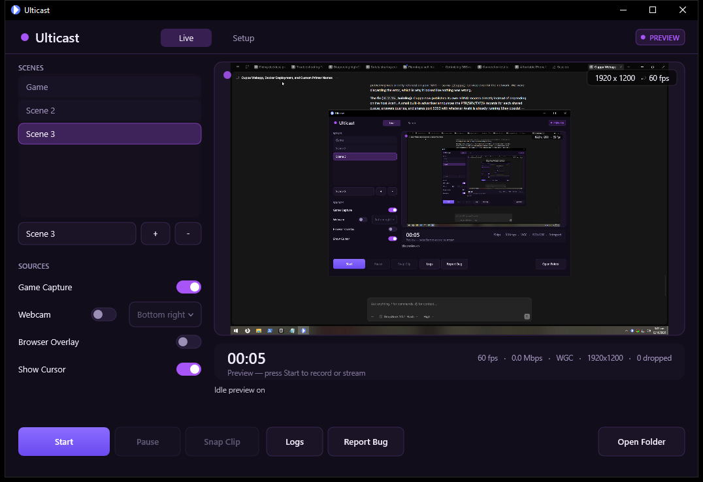
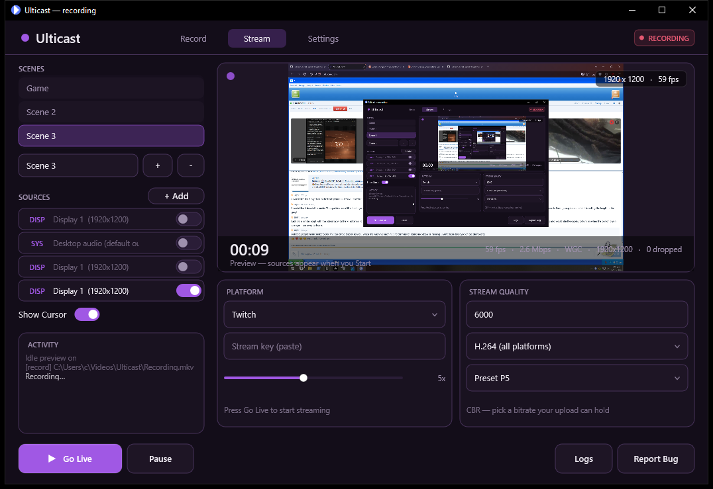
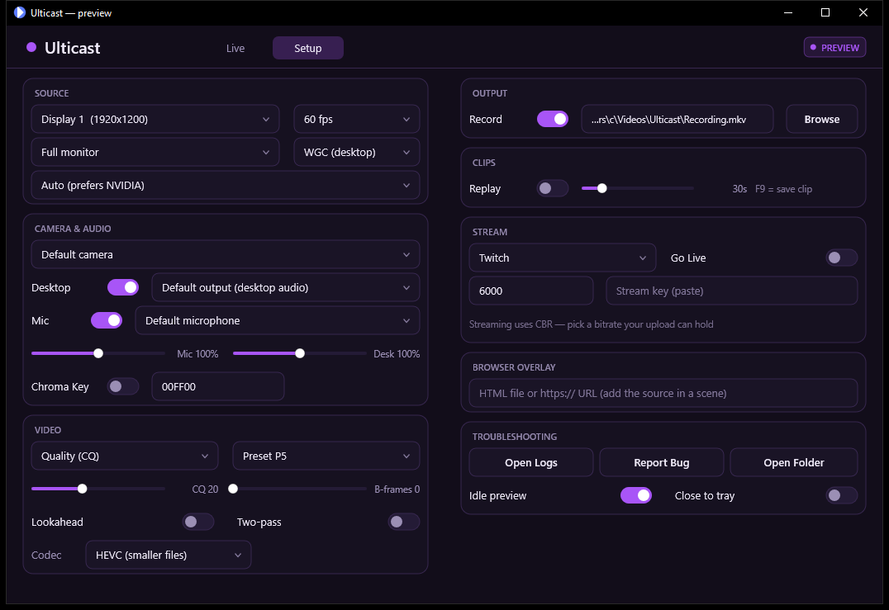

# Ulticast

A lean, GPU-first screen capture / recorder / streamer with a dark Direct2D UI.
Built from scratch to have the smallest possible per-frame cost on the capture path.

[](https://github.com/modnite/ulticast/actions/workflows/build.yml)
[](https://github.com/modnite/ulticast/releases/latest)

## Download & install

- **Installer (recommended):** grab `Ulticast-Setup-x.y.z.exe` from the
  [latest release](https://github.com/modnite/ulticast/releases/latest). Installs both executables,
  the FFmpeg runtime and the browser-overlay runtime (CEF); Start Menu and desktop shortcuts are
  optional tasks in the installer.
  Windows 10 2004+ or Windows 11, x64, NVIDIA GPU (NVENC).
- **Portable:** `Ulticast-portable-x.y.z.zip` — unzip anywhere and run `ulticast-ui.exe`.

Nothing driver-related is bundled: encoding uses the NVENC runtime that ships with your NVIDIA driver.

### Windows SmartScreen ("Windows protected your PC")

The binaries aren't Authenticode-signed yet, so Windows marks the download as *from the internet*
and SmartScreen shows its usual prompt. Two ways to handle it:

- **Right now, any build:** remove the download mark — right-click the file → **Properties** →
  tick **Unblock** → **OK**, or in PowerShell: `Unblock-File .\Ulticast-Setup-x.y.z.exe`.
  The prompt disappears because the file is no longer treated as an internet download.
- **Proper fix, one secret away:** the pipeline is already wired for signing. Add two repository
  secrets and every release is signed automatically:
  - `SIGNING_PFX_BASE64` — `[Convert]::ToBase64String([IO.File]::ReadAllBytes('cert.pfx'))`
  - `SIGNING_PFX_PASSWORD` — the `.pfx` password

  The workflow then signs `ulticast.exe` and `ulticast-ui.exe` before packing, and Inno Setup signs
  the installer **and** the uninstaller stub with the same certificate. Locally:
  `tools\sign.ps1 -PfxPath cert.pfx -PfxPassword ***`.

  Certificate options: **EV** code-signing certs earn SmartScreen trust immediately (~$400/yr);
  **OV** certs build reputation as downloads accumulate (~$200/yr); **Azure Trusted Signing** is
  Microsoft's cloud service (~$10/month, requires identity validation). All three work with the
  secrets above — no code changes needed.

## Bug reports & diagnostics

Everything needed for a good report is built in:

- In the UI: **Report Bug** collects a redacted system report
  (`%LOCALAPPDATA%\Ulticast\diagnostics.txt`), opens it, and takes you to the issue form.
  **Logs** opens the log folder.
- From a terminal: `ulticast.exe --diagnostics` (prints and saves the report), `--open-logs`.
- Every run writes a log to `%LOCALAPPDATA%\Ulticast\logs` (newest 20 kept) with per-second audio
  device rates, capture-backend decisions, encoder/replay state and errors.
- The report covers OS/CPU/RAM/GPU, monitors, audio devices, cameras, the NVENC API version and the
  log tail. **The stream key is never included** (settings are redacted).

Please attach `diagnostics-*.txt` and the newest log to
[the bug report form](https://github.com/modnite/ulticast/issues/new?template=bug_report.yml).







## Architecture

```
                     ┌──────────────────────────── Session (engine) ───────────────────────────┐
 capture (WGC/DXGI) ─┤ scene texture ─ compositor (webcam PiP) ─┬─ rec encoder (HEVC/H.264) ─ mux ─ file
                     │                                        ├─ stream encoder (H.264 CBR) ─ mux ─ RTMP(S)
                     │                                        └─ replay encoder ─ RAM packet ring ─ clip
 audio (WASAPI loopback+mic) ─ mix ─ AAC ───────────────────────┴─ all outputs
                     └─────────────────────────────────────────────────────────────────────────┘
   driven by:  Ulticast.exe (CLI, automation)   or   Ulticast-ui.exe (the UI)
```

- **One D3D11 device, one capture thread** for the video path; the scene is composited in a single
  pass directly into the NVENC input texture.
- **FFmpeg does container/network only** (plus AAC).
- **Replay buffer holds encoded packets in RAM** (30 s of 1080p60 is tens of MB, not 14 GB).
- The UI owns its own D3D device; the live preview travels over a shared texture, so the capture
  thread and the UI never share a command context.

## Status

- **Stage 1** capture / NVENC / muxing — done, verified
- **Stage 2** audio, pause, streaming + reconnect — done, verified
- **Stage 3** DXGI backend, scene compositor, webcam overlay, replay buffer, hotkeys — done, verified
- **Stage 4** UI (Direct2D, tray, settings, dual output) — done, verified, polished
- **Stage 5** chroma key + **browser overlays (CEF offscreen rendering)** + **DXGI cursor compositing** — done, verified
- **Stage 6** multi-scene / multi-source engine (live scene switching) + two-page UI redesign — done, verified
- **Stage 7** usability pass: DPI-proof window (resizable/maximizable), idle preview, GPU picker +
  NVIDIA auto-select, CBR + full CQ range, encoder options, audio device/gain controls, live webcam
  drag, close-to-tray, start-menu shortcut option — done, verified
- **Stage 8** installer/UX hardening: installer force-closes any running instance (incl. tray-hidden
  UI and CEF helpers), single-instance app guard, carded Setup layout with proper control spacing — done, verified
- **Stage 9** Record / Stream / Settings surfaces with per-mode settings, independent runtime outputs
  (start recording and go live separately, no interruption), expanded source list (display / window /
  game / video devices incl. capture cards / mic / desktop audio / browser), per-scene sources with
  live add/configure/remove — done, verified
- **Stage 10** roadmap: mic noise gate (live threshold, CLI `--gate`) — done, verified
- **Stage 11** (unreleased): mic compressor (-1 dB safety clip), mic monitoring, multiple capture
  sources per scene (second monitor/window as a PiP layer), DirectShow camera fallback, audio device
  auto-recovery, themes (8 accents + light/dark), dead-space-free layout, cleaner action buttons with
  record/play/stop glyphs — built and tested locally (12/12 smoke tests)
- **Stage 12** Twitch OAuth device-code login (connect once, stream key stays current),
  DirectShow camera fallback, mic monitoring, audio device auto-recovery — released in v0.9.0
- **Stage 13** clip-hotkey picker (F6–F12/Off), MKV/MP4 container choice, separate
  mic track, source z-order chevrons, 250 ms scene crossfade, per-output encoder settings
  (record vs stream), per-source device selection (Settings combos removed), window capture
  fixed for odd sizes/resizes, and the popup/timer/browser-overlay fixes — released in v0.9.1
- **Stage 14** "Show Cursor" now works on the default WGC backend too (it was hard-coded on there;
  only the DXGI path honoured the toggle). The smoke test covers both backends — released in v0.9.2
- **Stage 15** text fields behave like native edit controls (caret by click, drag/double-click
  selection, arrow/word/Home/End navigation, Shift selection, Ctrl+A/C/X/V, Backspace/Delete,
  horizontal scrolling); browser overlay gets a **Test overlay** button, a **Reload** button and
  **live load status** in the card, plus the Chromium log in diagnostics — released in v0.9.3
- **Stage 16** UI lessons from the VLC redesign (Juxtopposed): Settings is now a **category rail**
  (Capture / Camera & Audio / Filters / Appearance / Browser / Behavior / Help / About) with the
  **live preview always visible** beside it, **friendly mic-filter presets** (Off / Voice /
  Broadcast) next to the sliders, human-readable status (recording / streaming / replay / capture)
  and a **shortcuts card**. Also in this release: triple-click selects all in text boxes and drag
  selection extends by word after a double-click; the tray icon is removed **while the window still
  exists** (it used to linger as a ghost); the browser overlay is tracked by browser id, so Exit no
  longer waits on CEF; and X with "Close to tray" explains itself with a one-time tray notice —
  released in v0.9.4
- **Stage 17** a focused UI pass: **sources never assume a target** — a Window source asks which
  window before it exists (and the engine refuses to start one without a window instead of quietly
  capturing the whole monitor), Display/Game ask when there is more than one monitor, and camera /
  mic / desktop-audio sources open their device list immediately; **keyboard access** — Tab /
  Shift+Tab move a focus ring through every control, Enter/Space activate, arrows drive popups and
  sliders; Record and Stream lost their third card (the encoders moved to **Settings > Encoding**);
  labels are ellipsized instead of clipped; the window cannot be shrunk below a readable size —
  released in v0.9.5
- **Stage 18** the preview now tracks the capture rate: the engine was copying the preview texture
  only every third frame (a hard ~20 fps ceiling) and the UI's WM_TIMER coalesced against pending
  paints (about half the requested rate). The copy happens every frame, the paint self-schedules at
  the configured rate with a 1 ms system timer, and vsync is dropped while live so a hidden window
  cannot stall the loop. Measured: **capture 59 fps / preview 59 fps, 3.9 ms per frame**. Also:
  a **dedicated overlay preview** in Settings > Browser (the browser's own render, drawn zero-copy
  from a shared texture), the overlay **reloads as you type** its URL (and a bare host such as
  `example.com` is now treated as a web address, not a file), the page switcher became a **menu
  bar** with an accent underline, and slider drags persist on release — released in v0.9.6
- **Stage 19** preview **fullscreen** (the corner button or F11; Esc restores the window) and per-source
  **orientation**: flip horizontal/vertical and 90° rotation steps, applied in the compositor's vertex
  shader so they cost nothing, exposed in each source's properties popup and on the CLI
  (`--flip-h`, `--flip-v`, `--rotate N`). The engine suite proves the flip is a true mirror
  (mirrored difference 2.6 vs 41.3 unmirrored) — released in v0.9.8
- **Stage 20** the visual overhaul plus the two preview features: a **pop-out preview window** (its own
  resizable window, F11 inside it, double-click to fill), **any layer can be moved and resized
  directly on the preview** (click to select, drag to move, corner handles to resize, "Reset position
  and size" in the properties popup), and a quieter interface — one border weight, one hint style,
  tighter 30 px rows, a status block in the rail instead of an empty activity box, redundant hint
  lines removed, a page backdrop behind the overlay preview. Also fixed: the Settings card stretch
  repainted its own contents (that was the "transparent" look) — released in v0.9.9
- **Stage 21** ordering and click fixes plus the layout: **any source can be reordered** (only the base
  capture stays first), **scenes are reorderable** (chevrons on each scene row), clicking a source row a
  second time **closes** its list instead of reopening it, the status chip and the preview's recording
  dot are gone, and the **preview now inhabits the top band** (full content width) with the scene rail
  and the cards below it — released in v0.9.10
- **Stage 22** audio moved out of the scene-source model into a **mixer strip** with real metering:
  each channel (mic, desktop) has mute, gain and a live **post-fader, post-filter level meter**
  (green/amber/red with a peak-hold marker, dB readout) fed from the audio thread; the mic and
  desktop entries are gone from the add-source menu and the source list. The preview's info banner
  moved out of the picture (state, timer and numbers now sit in the rail and the transport row), the
  resolution pill was removed, and the presentation path switched to a non-blocking vsync present
  with a frame-latency cap (the Windows 11 queue-full stall) plus a log line recording the display
  mode — released in v0.9.11
- Next: dockable/resizable panels, per-source filters and transitions (derived from how established
  capture apps structure this), then on-hardware validation on the RTX 3080 rig

## The UI (Ulticast-ui.exe)

Dark theme, custom-drawn controls, and **three surfaces**: **Record**, **Stream** and **Settings** —
each mode has its own layout, its own big action button and its own settings, so nothing is crammed
together (the same separation ShadowPlay/OBS users expect).

| Surface | Contents |
|---|---|
| **Record** | scenes + sources rail · live preview (stats overlaid) · **RECORDING** (path, codec, **container MKV/MP4**, **separate mic track**), **CLIPS** (replay toggle, buffer length, **clip hotkey picker F6–F12/Off**), **ENCODING** (CQ or CBR, preset, B-frames, lookahead, two-pass) · transport: **Start/Stop Recording**, Pause, Snap Clip, Open Folder |
| **Stream** | scenes + sources rail · live preview · **PLATFORM** (Twitch / YouTube / Facebook / custom, stream key or RTMP URL, reconnect attempts, bitrate, H.264/HEVC) · **STREAM ENCODER** (own preset, B-frames, lookahead, two-pass — independent from recording) · **TWITCH ACCOUNT** (Connect once, key stays current) · transport: **Go Live / End Stream**, Pause, Snap Clip |
| **Settings** | **category rail** — Capture / Camera & Audio / Filters / Appearance / Browser / Behavior / **Encoding** / Help / About — with a **live preview** beside it: capture defaults (monitor, window, backend, fps, **GPU**), camera & audio (gains, chroma key; **devices are picked per source**), **mic filters** (**presets** + noise gate, compressor, mic monitoring), **appearance** (8 accents + light/dark + theme sample), browser overlay (**URL + Test overlay + Reload + live load status**), behavior (idle preview, close to tray, **scene fade**), **record/stream encoders** (CQ or CBR, preset, B-frames, lookahead, two-pass), **shortcuts**, troubleshooting, about |

**Sources** (per scene, OBS-style — add with **+ Add**, click a row to configure it):

| Type | Tag | Options |
|---|---|---|
| Display Capture | DISP | monitor — **add more than one to layer a second monitor as a PiP** |
| Window Capture | WIN | **asks which window before the source is created** — a window source never falls back to the whole display |
| Game Capture | GAME | monitor + DXGI duplication (fullscreen games, first capture) |
| Video Capture Device | VID | **any camera or capture card** — Media Foundation first, with an automatic **DirectShow fallback** for virtual cameras MF cannot see (some NVIDIA Broadcast builds, Snap Camera); multiple devices can run at once, each with its own PiP corner or free position (drag it on the preview) |
| Microphone | MIC | capture device |
| Desktop Audio | SYS | output device (loopback) |
| Browser Overlay | WEB | HTML file / https:// URL — set it in Settings, or press **Test overlay** to add the source with a built-in demo page |

- **Independent outputs**: Start Recording and Go Live are separate actions; either can start the
  session and the other can be switched on later without interrupting the first (recording and
  streaming use separate NVENC sessions).
- **Audio filters**: noise gate (2 ms attack / 120 ms hold / 150 ms release), a compressor with a
  -1 dB safety clip, and **mic monitoring** (hear the post-filter mic in your headphones); all
  adjustable live while recording (`--gate DB`, `--comp DB`, `--comp-ratio R`, `--monitor-mic`).
- **Device auto-recovery**: unplugging/replugging an output (or waking a sleeping device) restarts
  that endpoint in place — the session keeps running instead of losing audio.
- **Themes**: eight accent colours (violet, cyan, emerald, amber, rose, azure, magenta, slate) with
  light and dark variants; everything (buttons, switches, sliders, caption bar) follows the accent.
- **Layout**: no dead space — the rail's leftover room holds the activity log, mode cards fill their
  rows, and the Settings columns are balanced top to bottom.
- **Scenes**: each scene owns its source list; switching applies live while recording and
  **crossfades** the outgoing picture over the new one (250 ms, toggle in Settings → Behavior).
- **Source order**: the ▲▼ chevrons on a source row move it up/down in the layer stack (capture
  sources stay pinned so the primary capture never changes under a running session).
- **Window capture** handles odd-sized windows and mid-session resizes (the canvas rounds to even,
  the frame is drawn scaled/letterboxed into it).
- **Per-output encoders**: recording and streaming each have their own preset, B-frames, lookahead
  and two-pass settings; the container is MKV (crash-safe) or MP4, and the mic can be written to a
  separate track for editing.
- **Idle preview**: while not producing output, Ulticast composites the scene into the preview only —
  the camera opens only when recording, streaming or the replay buffer is armed.
- **Replay buffer**: toggle it in Record > CLIPS; Snap Clip saves the last moments (hotkey picker:
  F6–F12 or Off).
- **No implicit hooks**: WGC is the default; DXGI duplication is an explicit per-source choice.
- **Dropped-frame + uptime indicators**, live activity strip, tray menu with the same actions.
- **Settings** persist to `%APPDATA%\Ulticast\settings.ini`; the stream key is stored
  **DPAPI-encrypted** (per user, never plaintext).
- **Text fields are real edit controls**: click to place the caret, drag to select, double-click a
  word (drag then extends by whole words), triple-click selects all, Shift+click/arrows extend,
  Ctrl+arrows jump by word, Ctrl+A/C/X/V, Backspace/Delete, and the text scrolls sideways to keep
  the caret visible.
- **Settings you can see the effect of**: the page is split into categories and keeps the **live
  preview** on screen, so camera, chroma and audio changes are judged while you make them (the
  VLC-redesign lesson: never hide the picture while tweaking).
- **The preview runs at the capture rate.** The engine hands the composited frame to the UI every
  frame over a shared texture (no CPU copy, no readback) and the paint self-schedules at the
  configured fps; the stats strip shows both the capture and the on-screen rate (`view 59 fps`).
- **Browser overlays have their own preview** in Settings > Browser: the overlay's render, not the
  scene, updated as you type the URL (a bare `example.com` is treated as `https://example.com`).
- **Keyboard access**: Tab / Shift+Tab move a focus ring through every control on the page,
  Enter/Space activate the focused one, arrows drive open popups and adjust focused sliders, and
  Esc closes menus or leaves a text box. Clicking a control focuses it too, so the keyboard takes
  over where the mouse left off. (No screen-reader support: the UI is a custom Direct2D canvas.)
- **Sources never assume a target**: adding a Window source asks which window first, Display/Game
  ask when more than one monitor is attached, and camera / mic / desktop-audio sources open their
  device list immediately. A window source without a window refuses to start rather than capturing
  a monitor.
- **Labels never clip mid-character**: long source names are ellipsized, and the window cannot be
  resized below a readable scale (85% of the design).

## Verified on the RTX 2060 test machine

| Test | Result |
|---|---|
| UI launch + rendering | dark D2D surface, custom widgets, live preview |
| UI click-driven Start/Stop | recorded `Videos\Ulticast\Recording.mkv` (HEVC + AAC) |
| Live preview | scene texture shared to the UI, ~20 fps refresh, resolution/fps overlay |
| Activity strip | engine log lines surfaced in the UI ("Recording started", file path) |
| **Chroma key** | green window keyed to pure black at its pixels; control run unkeyed; unrelated pixels untouched |
| **Browser overlay (CEF)** | HTML rendered offscreen by Chromium 150 and composited: red square, green text, and a 50% white band blended mathematically exactly over the desktop; transparent areas show through |
| **Browser overlay (live site)** | a real HTTPS page (`https://example.com`) loaded in the offscreen browser and composited into the recording; the card reports `loaded (HTTP 200)`, and failures would report `load failed: …` |
| **DXGI cursor** | cursor shape queried via GDI (works with a parked cursor, where duplication reports nothing); tip/body pixels verified at a known coordinate while everything around stays untouched |
| Tray + hotkey | tray icon registered; F9 clip hotkey registered globally |
| **Tray & exit** | the icon is removed while the window still exists (no ghost in the notification area); with the browser overlay live, tray **Exit** quits in ~0.3 s; X with "Close to tray" hides the window and shows a one-time tray notice |
| **Window source guard** | a window source with no window refuses to start ("window source has no window selected") instead of capturing the monitor — asserted in the UI harness against a crafted scene |
| **Keyboard navigation** | Tab/Shift+Tab focus ring, Enter/Space activation, arrows on popups and sliders — asserted by the UI harness (pixel + settings checks) |
| **Preview rate** | measured on screen: capture 59 fps / preview 59 fps, 3.9 ms per frame (the strip shows both; the engine used to hand over every third frame) |
| **Menu bar** | Record / Stream / Settings as flat menu items with an accent underline; the status pill (PREVIEW / RECORDING / LIVE) stays on the right |
| **Fullscreen preview** | the corner button or F11 fills the screen with the preview alone; Esc restores the previous window state |
| **Source orientation** | flip H/V and 90° rotation steps per source, applied on the GPU (vertex shader). CLI: `--flip-h`, `--flip-v`, `--rotate N`; asserted by a mirror comparison in the engine suite |
| **Preview pop-out** | the preview detaches into its own resizable window (F11 fills it, double-click toggles, closing it leaves the app untouched) — asserted by the UI harness |
| **Layer drag / resize** | click a layer on the preview to select it, drag to move, drag a corner handle to resize; positions are fractional so they survive canvas changes — asserted by the UI harness |
| Settings persistence | `settings.ini` written and re-loaded on next launch |
| Engine regressions (CLI) | pause (8 s → 6 s media), webcam + replay + audio combo, RTMP round-trip |
| **Dual output** | H.264 → RTMP and HEVC → disk simultaneously, both ~5.95 s |
| **Twitch account linking** | device-code OAuth completed with a real Twitch account — channel + stream key fetched automatically, token stored DPAPI-encrypted |
| **Twitch live stream** | went live successfully from Ulticast (H.264 CBR → `rtmp://live.twitch.tv/app`) |
| Footprint | 34% of one core / 116 MB with webcam + replay + recording + audio |

## Build from source

Requirements: Visual Studio 2022 (C++ tools), CMake 3.28+, Windows SDK, git, and ~4 GB of disk for
the vendored dependencies.

```
git clone https://github.com/modnite/ulticast.git
cd ulticast
powershell -ExecutionPolicy Bypass -File tools\fetch-deps.ps1
cmake -S . -B build -A x64
cmake --build build --config Release --parallel
```

Produces `ulticast.exe` (CLI) and `ulticast-ui.exe` (GUI) in `build/Release`.
`tools/fetch-deps.ps1` downloads the pinned CEF 150 distribution, the BtbN FFmpeg LGPL shared build
and nv-codec-headers into `third_party/` (git-ignored).

CI (`.github/workflows/build.yml`) builds on a Windows runner for every push; pushing a `v*` tag
produces the installer and portable zip on the Releases page. Two test harnesses run there too:

- `tools/smoke-test.ps1` — end-to-end engine checks against real files and pixels (needs an NVIDIA
  GPU; run it locally): record/pause/RTMP/replay/dual output/browser overlay/noise gate/compressor/
  mic monitoring/DirectShow/window capture/cursor toggling on both backends/flip orientation.
- `tools/ui-test.ps1` — UI click-through automation (41 checks): launches the app against a
  throwaway profile, drives it with synthetic clicks and key events at design coordinates, and
  asserts on pixels and the persisted settings (pages, tab switching, accent swatches, theme repaint
  + persistence, add-source menu open/close, **text editing** — Ctrl+A, typing at the caret,
  Backspace, click-to-place-caret — **settings categories**, **live preview**, **mic presets**,
  **window-source target prompt**, **keyboard navigation** (Tab + Enter, Space on a switch, arrows
  on a slider), **Test overlay wiring**, hotkey picker, separate-mic-track toggle, scene fade,
  **Close to tray / tray Exit with the overlay live**, X-to-exit).
  Screenshots land in `test/ui/`. Runs on any machine with an interactive desktop — **GitHub-hosted
  Windows runners have no desktop, so the CI step reports SKIP there**; run it locally (or on a
  self-hosted runner) before releasing. CI still uploads the screenshots when it does run.

## CLI

```
Ulticast --list | --list-audio
Ulticast --monitor 0 --seconds 30 --out clip.mkv
Ulticast --monitor 0 --webcam --webcam-device ZV-1 --replay --hotkey F9
Ulticast --platform twitch --key <key> --also-record backup.mkv
```

| Area | Flags |
|---|---|
| Capture | `--monitor N`, `--window T`, `--backend auto\|wgc\|dxgi`, `--adapter N`, `--fps N` |
| Output | `--out PATH\|none`, `--seconds N`, `--codec hevc\|h264`, `--cqp N` (1–51), `--cbr --bitrate N`, `--preset N`, `--bframes 0-4`, `--lookahead` |
| Scene | `--webcam`, `--webcam-device`, `--webcam-pos`, `--webcam-size`, `--chroma RRGGBB`, `--chroma-layer webcam\|capture`, `--browser URL\|FILE`, `--browser-size WxH` |
| Clips | `--replay`, `--replay-seconds`, `--replay-prefix`, `--hotkey`, `--clip-at` |
| Stream | `--platform`, `--key`, `--rtmp URL`, `--also-record PATH`, `--reconnect N` |
| Audio | `--no-audio`, `--no-desktop-audio`, `--mic`, `--mic-device`, `--desktop-device`, `--mic-gain X`, `--desktop-gain X`, `--gate DB`, `--comp DB`, `--comp-ratio R`, `--monitor-mic`, `--audio-bitrate N`, `--tracks 1\|2` |
| Diagnostics | `--diagnostics`, `--open-logs`, `--version`, `--twitch-login [--twitch-client-id ID]` |

## Streaming targets

| Platform | Ingest |
|---|---|
| Twitch | `rtmp://live.twitch.tv/app` |
| YouTube | `rtmps://a.rtmps.youtube.com/live2` |
| Facebook | `rtmps://live-api-s.facebook.com:443/rtmp/` |
| Kick / other | custom RTMP/RTMPS URL |

### Twitch account (no stream key pasting)

Ulticast ships a registered public Twitch client and uses the **OAuth device-code flow** — no
secret, no redirect, nothing to configure:

- In the UI: **Stream → Twitch Account → Connect Twitch**. A code appears and the activation page
  opens in your browser; enter the code and the app fetches your channel name and stream key
  automatically (the key is stored DPAPI-encrypted like any pasted key). Afterwards the button
  becomes **Refresh stream key**, which silently refreshes the token and re-reads the key.
- From a terminal: `ulticast.exe --twitch-login` prints the code, waits for confirmation, then
  prints the channel and stream key.

Scopes requested: `channel:read:stream_key` only.

## Known limitations

1. Window capture of Ulticast's *own* window returns black (WGC cannot capture this app's DXGI
   swapchain); every other window — games, browsers, Notepad — captures fine, including odd sizes.
2. Frame-counted CFR: capture slightly above 60 fps can stretch video media ~1% vs wall time.
3. Pause applies to recordings; the final AAC block (~21 ms) is not flushed at stop.
4. Browser overlays spin up a full Chromium (helper processes, ~300 MB runtime); the first
   paint takes a second or two after a session starts.
5. Cameras are exclusive: while recording, the selected camera belongs to Ulticast. The idle
   preview never opens the camera, and Stop releases it immediately.
6. Virtual cameras that only register with DirectShow are now listed and captured through a
   DirectShow fallback; if one still refuses, run `--diagnostics` and report it.

## Roadmap

- Everything on the original roadmap is done; next is on-hardware validation on the RTX 3080 rig
  and whatever that turns up.

### Done

- **Twitch login (OAuth device-code flow)**: Connect Twitch in the UI (or `--twitch-login` on the
  CLI) links the account and pulls the stream key automatically; tokens are refreshed silently and
  stored DPAPI-encrypted.
- **Audio filters, part 1**: mic noise gate with live threshold (`--gate DB`).
- **Audio filters, part 2**: mic compressor with live threshold/ratio and a -1 dB safety clip
  (`--comp DB`, `--comp-ratio R`).
- **Audio filters, part 3**: mic monitoring to the default output (`--monitor-mic`), with a
  headphones hint.
- **Multiple capture sources per scene**: extra display/window captures composite as PiP layers
  (position configurable per source).
- **DirectShow camera fallback**: video devices are listed from both Media Foundation and
  DirectShow, and the engine falls back to a DirectShow graph (SampleGrabber) when MF cannot open
  a device — verified with a real camera (`--force-dshow`).
- **Audio device auto-recovery**: lost endpoints reconnect in place instead of ending the session.
- **Themes**: 8 accent colours, light/dark, caption bar follows the accent.
